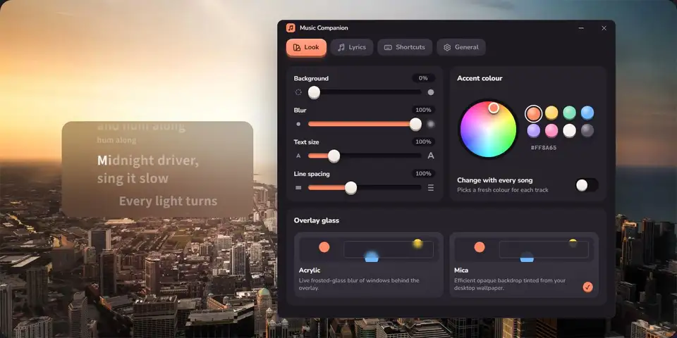
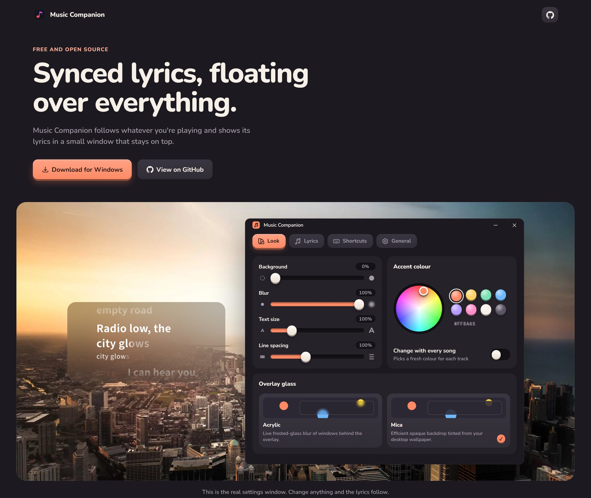
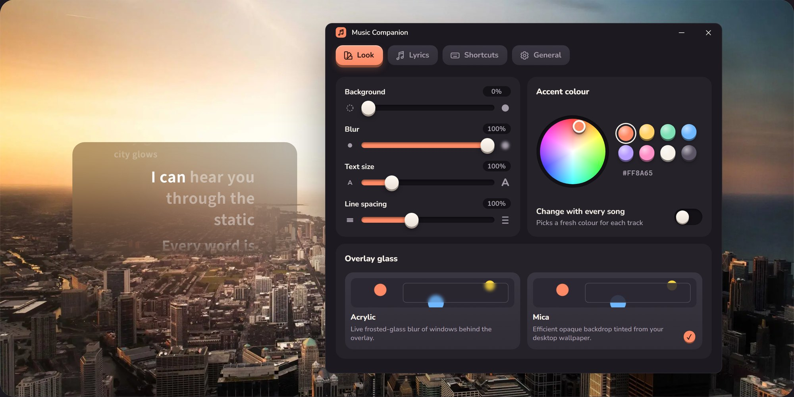
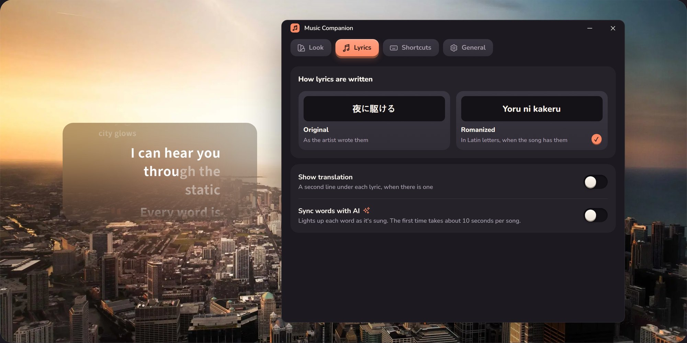
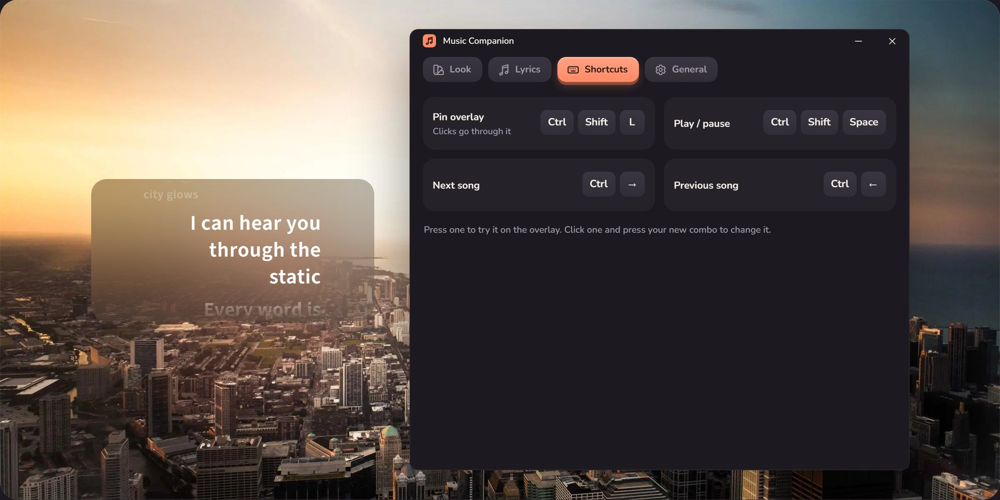
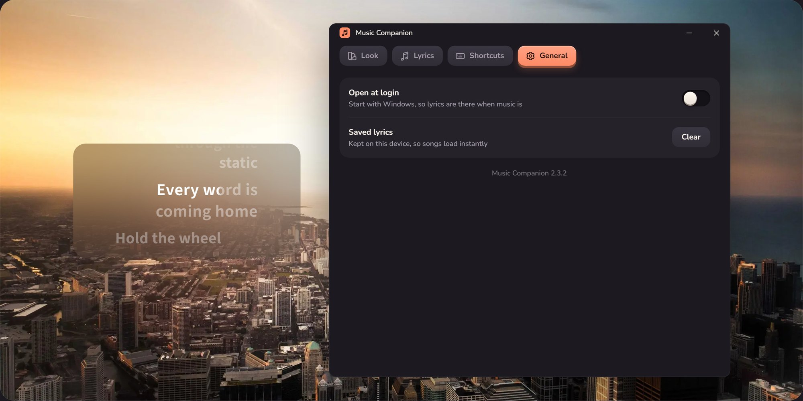
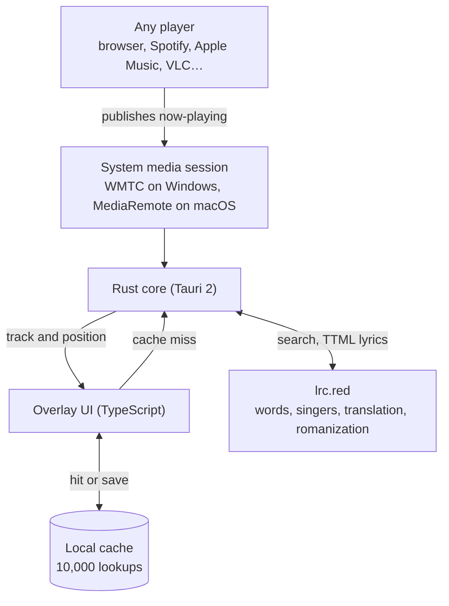

<p align="center">
  
</p>

<h1 align="center">Music Companion</h1>

<p align="center">
  <b>Synced lyrics, floating over everything.</b>
</p>

<p align="center">
  <a href="https://music-companion-orcin.vercel.app/"></a>
</p>

<p align="center">
  <a href="https://github.com/JustMarkDev/music-companion/releases/latest"></a>
  <a href="https://github.com/JustMarkDev/music-companion/releases"></a>
  <a href="https://github.com/JustMarkDev/music-companion/actions/workflows/ci.yml"></a>
  <a href="LICENSE"></a>
</p>

<p align="center">
  
  
  
  
  
</p>

<p align="center">
  <b>Music Companion</b> is a Windows 10/11 and macOS desktop lyrics overlay. It follows the active
  system media session, retrieves lyrics from <a href="https://lrc.red/">lrc.red</a>, and presents them
  in a transparent, always-on-top Tauri window.
</p>

<p align="center">
  <a href="https://music-companion-orcin.vercel.app/">Website</a> ·
  <a href="#download">Download</a> ·
  <a href="#see-it-in-action">Demo</a> ·
  <a href="#features">Features</a> ·
  <a href="#screenshots">Screenshots</a> ·
  <a href="#how-it-works">How it works</a> ·
  <a href="#project-pulse">Stats</a> ·
  <a href="#development">Development</a>
</p>

## Download

<p align="center">
  <a href="https://music-companion-orcin.vercel.app/"></a>
  &nbsp;
  <a href="https://github.com/JustMarkDev/music-companion/releases/latest"></a>
  &nbsp;
  <a href="https://github.com/JustMarkDev/music-companion/releases/latest"></a>
</p>

Grab the Windows NSIS `.exe` or the universal macOS `.dmg` from the
[latest release](https://github.com/JustMarkDev/music-companion/releases/latest). End users do not need Bun,
Node.js, Rust, or CMake. See [Installation and use](#installation-and-use) for first-launch notes.

## See it in action

<p align="center">
  
</p>

<p align="center">
  <a href="https://music-companion-orcin.vercel.app/"></a>
</p>

## Website

**[music-companion-orcin.vercel.app](https://music-companion-orcin.vercel.app/)** has a live demo: the real settings
window, running in the page, next to a lyrics preview over a city photo. Change a slider and the lyrics follow. The
screenshots in this README are captured from it.

## Features

<table>
  <tr>
    <td width="33%" valign="top">
      <h4>🎤 Word-by-word sync</h4>
      Highlights each word as it is sung when lrc.red times individual words (many tracks), and line by line otherwise.
    </td>
    <td width="33%" valign="top">
      <h4>🌏 Romanization</h4>
      Japanese, Korean, Chinese, Arabic, and Devanagari lyrics, romanized with the transliteration lrc.red provides.
    </td>
    <td width="33%" valign="top">
      <h4>🌐 Translation</h4>
      Optionally shows lrc.red's translation under each line. Translations that only echo the line are hidden.
    </td>
  </tr>
  <tr>
    <td valign="top">
      <h4>👥 Duets &amp; backing vocals</h4>
      The second singer of a duet sits on the right, and background vocals appear smaller under the line, filled word by word.
    </td>
    <td valign="top">
      <h4>✨ AI word sync</h4>
      Optionally asks lrc.red's alignment model to time every word of songs that are not word-timed. The result is saved.
    </td>
    <td valign="top">
      <h4>🪟 Glass overlay</h4>
      Transparent and always on top, with Acrylic on Windows and Liquid Glass on macOS. Click-through on demand.
    </td>
  </tr>
  <tr>
    <td valign="top">
      <h4>🎹 Global hotkeys</h4>
      Configurable play/pause, next, previous, and click-through shortcuts that work in every app.
    </td>
    <td valign="top">
      <h4>🎨 Make it yours</h4>
      Opacity, blur, typography, and accent colour, including a fresh accent for every song.
    </td>
    <td valign="top">
      <h4>💾 Instant repeats</h4>
      Caches up to 10,000 successful lookups on the device and restores overlay position, size, and settings.
    </td>
  </tr>
</table>

<details>
<summary><b>Full feature list</b></summary>

<br />

- Follows the system media session on both platforms, including desktop players
  and browsers.
- Displays synchronized lyrics with smooth highlighting and scrolling.
- Highlights word by word when lrc.red times individual words (many tracks), and line by
  line otherwise. Romanized lyrics keep their own word timing.
- Reads each song as a TTML file from lrc.red, the only lyrics provider. Lyrics, romanization,
  translation, singers, and background vocals all come from that one file.
- Romanizes Japanese, Korean, Chinese, Arabic, and Devanagari lyrics with the transliteration
  lrc.red provides. Songs without one fall back to the original; nothing is romanized on the
  device. Romanized mode shows the romanization as the lyric line. Original + romanized keeps
  the original and puts each word's romanization above it (the whole romanized line when words
  can't be paired), and hides the translation, which would need a third line.
- Optionally shows lrc.red's translation under each line (Settings → Show translation, off by
  default) when the song has one. Translations that only echo the line, such as
  English translations of English lines, are hidden.
- Sets the second singer of a duet on the right and shows background vocals smaller under the
  line, filled word by word like the lead.
- Optionally asks lrc.red's alignment model to time every word of songs whose lyrics are not
  word-timed (Settings → Sync words with AI, off by default). The first sync of a song can take
  10 seconds or more; the lyrics on screen are upgraded in place and the result is saved.
- Recognizes instrumental tracks and common track variants (remixes, live cuts, covers) from the
  title, and says so instead of silently presenting a poor match.
- Normalizes browser metadata such as `- Topic`, `VEVO`, and `Artist - Song`
  titles for display and lyrics searches. Official-video labels are removed,
  and their title artist takes precedence over mismatched YouTube channel metadata.
- Caches up to 10,000 successful lookups on the device and restores overlay position, size,
  and settings.
- Provides opacity, blur, typography, accent-color, start-at-login, and cache
  controls in a separate settings window.
- Supports configurable global playback hotkeys, with a Windows media-key
  fallback for browser sessions that decline next or previous commands.
- Supports a global click-through toggle and tray or menu bar recovery.
- Checks for signed updates in release builds on Windows.

</details>

## Screenshots

Captured from the [website](https://music-companion-orcin.vercel.app/)'s live demo, which runs the app's real settings window.

<table>
  <tr>
    <td width="50%" align="center"></td>
    <td width="50%" align="center"></td>
  </tr>
  <tr>
    <td align="center"><sub><b>Look</b><br />Opacity, blur, text size, spacing, accent, glass</sub></td>
    <td align="center"><sub><b>Lyrics</b><br />Original or romanized, translation, AI word sync</sub></td>
  </tr>
  <tr>
    <td align="center"></td>
    <td align="center"></td>
  </tr>
  <tr>
    <td align="center"><sub><b>Shortcuts</b><br />Global hotkeys you can rebind</sub></td>
    <td align="center"><sub><b>General</b><br />Open at login, saved lyrics</sub></td>
  </tr>
</table>

## How it works



## Project pulse

Live numbers, straight from GitHub. They update on their own.

<p align="center">
  
  
  
</p>

<p align="center">
  
  
  
  
  
</p>

<p align="center">
  
  
  
</p>

## Platform support

| Area                         | Windows 10/11                           | macOS 11 and later                                                     |
| ---------------------------- | --------------------------------------- | ---------------------------------------------------------------------- |
| Media session                | Windows Media Transport Controls (WMTC) | `MediaRemote`, read through the bundled adapter                        |
| Overlay backdrop             | Mica or Acrylic                         | Liquid Glass on macOS 26, `NSVisualEffectView` earlier                 |
| Stacking                     | Repeated topmost re-assertion           | Raised window level, visible on every Space and beside fullscreen apps |
| Start at login               | `Run` registry key                      | Launch agent                                                           |
| Click-through toggle         | `Ctrl+Shift+L`                          | `⇧⌘L`                                                                  |
| Next / previous / play-pause | `Ctrl+→`, `Ctrl+←`, `Ctrl+Shift+Space`  | `⌃⌘→`, `⌃⌘←`, `⇧⌘Space`                                                |
| Packaging                    | NSIS `.exe` installer                   | Universal `.dmg` (Apple Silicon and Intel)                             |
| Automatic updates            | Yes, signed                             | Not yet; see [macOS updates](#macos-updates)                           |

macOS transport shortcuts include Command because macOS reserves `Ctrl+→` and
`Ctrl+←` for Mission Control.

### How macOS reads the now-playing session

macOS has no public equivalent of WMTC, and since macOS 15.4 Apple has refused
`MediaRemote` access to applications without a private entitlement. Music
Companion therefore bundles [`mediaremote-adapter`](https://github.com/ungive/mediaremote-adapter)
(BSD 3-Clause) as a pinned submodule under `src-tauri/vendor/`. The adapter is
loaded by `/usr/bin/perl`, which Apple still entitles, and streams metadata,
position, playback state, and the owning application for every player the system
knows about. Playback commands travel back the same way.

If that adapter cannot reach `MediaRemote`, the overlay falls back to AppleScript
against Music and Spotify. The fallback asks for Automation permission on first
use and cannot see browser sessions, so YouTube and other web players stop
appearing until the adapter works again. The Rust log records which backend is
active at startup.

Because the adapter depends on a private framework, a future macOS release could
break it. The AppleScript fallback exists so the overlay keeps working if that
happens.

## Technology stack

<p>
  
  
  
  
  
</p>

- Tauri 2 and Rust provide platform integration, media-session monitoring, the
  tray and menu bar, networking, persistence, and updates.
- TypeScript, HTML, and CSS implement the overlay and settings interface.
- Bun manages frontend dependencies and scripts.
- Vite+ provides development, checking, linting, formatting, and builds.

## Installation and use

Download the installer for your platform from the
[latest GitHub release](https://github.com/JustMarkDev/music-companion/releases/latest):

- Windows: the NSIS `.exe`.
- macOS: the universal `.dmg`, then drag Music Companion to Applications.

End users do not need Bun, Node.js, Rust, or CMake.

macOS builds are not yet notarized, so Gatekeeper blocks the first launch. Open
Music Companion once with Control-click then **Open**, or allow it under **System
Settings → Privacy & Security**. Signing and notarization activate as soon as
Developer ID credentials are added to the release workflow, with no code change.

Start Music Companion and play a track in any player the system reports. Move the
pointer near the top of the overlay to reveal its controls. Drag the top area to
move it, resize it from the window edges, and open settings with the gear button,
a double-click, or a right-click in the lyric area. Switching to Music Companion with
Alt+Tab or Cmd+Tab moves the pointer onto the top area, ready to drag.

Closing the overlay hides it. On Windows it hides to the system tray, and on macOS
it hides to the menu bar while staying in the Dock. If click-through mode makes the
window unselectable, left-click the tray or menu bar icon to show and unlock it.

## Troubleshooting

- If no player appears, start playback once so the player publishes media metadata.
- If the wrong player is selected, pause other players and resume or change tracks
  in the intended player.
- If lyrics are incorrect or stale, clear the lyrics cache from settings.
- If the window appears closed, check the system tray or menu bar before starting
  another copy.
- Windows only: if the window does not render, install or repair Microsoft
  WebView2 Runtime.
- macOS only: if only Music and Spotify are detected, the overlay has fallen back
  to AppleScript. Check the Rust log for the active backend.
- macOS only: if the overlay reports no session at all, confirm that something is
  playing in a player that appears in Control Center's Now Playing tile, since
  that is the same source the overlay reads.

## Development

Prerequisites on both platforms are Bun, Node.js 20 or newer, and stable Rust.
Vite+ is installed locally.

- Windows: Windows 10 or 11, the Rust MSVC toolchain, and Microsoft WebView2
  Runtime.
- macOS: macOS 11 or later, Xcode Command Line Tools, and CMake
  (`brew install cmake`) to compile the bundled MediaRemote adapter.

Clone with submodules so the macOS adapter source is present:

```bash
git clone --recurse-submodules https://github.com/JustMarkDev/music-companion.git
```

In an existing clone, run `git submodule update --init --recursive`.

```bash
bun install --frozen-lockfile
bun run tauri:dev
```

The development server listens on `http://127.0.0.1:1421`. Development builds
emit `[latency]` diagnostics for media refreshes, IPC, cache activity, and lyrics
provider requests in the Rust terminal and WebView console.

On macOS, `build.rs` compiles the adapter framework into `src-tauri/resources/macos/`,
which is generated output and is not committed.

> **Tip:** run `bun run dev` and open `http://127.0.0.1:1421/` in a browser to see the overlay with a
> sample song, with no Tauri or media session needed, or add `?view=settings` for the settings window.

## Quality checks

```bash
bun run check
bun run lint
bun run format:check
cargo fmt --manifest-path src-tauri/Cargo.toml -- --check
cargo clippy --manifest-path src-tauri/Cargo.toml --all-targets -- -D warnings
cargo test --manifest-path src-tauri/Cargo.toml
bun run build
bun audit
cd src-tauri
cargo audit
```

Run `bun run format` and `cargo fmt --manifest-path src-tauri/Cargo.toml` to
apply formatting locally.

## Build and release

```bash
bun run tauri:build           # host platform
bun run tauri:build:windows   # Windows x86-64 NSIS installer
bun run tauri:build:macos     # universal macOS .app and .dmg
```

Artifacts are written below:

- `src-tauri/target/x86_64-pc-windows-msvc/release/bundle/nsis/`
- `src-tauri/target/universal-apple-darwin/release/bundle/dmg/`

A universal macOS build needs both Rust targets:

```bash
rustup target add aarch64-apple-darwin x86_64-apple-darwin
```

Approved releases are published from version tags matching `v*`. The Windows job
also creates signed Tauri updater artifacts.

### macOS updates

macOS automatic updates are deliberately disabled, and the macOS release job does
not publish updater metadata, because replacing an installed app bundle in place
requires a Developer ID signature that Gatekeeper accepts. To enable them, add
`APPLE_CERTIFICATE`, `APPLE_CERTIFICATE_PASSWORD`, `APPLE_SIGNING_IDENTITY`,
`APPLE_ID`, `APPLE_PASSWORD`, and `APPLE_TEAM_ID` as repository secrets, then set
`createUpdaterArtifacts` to `true` in `src-tauri/tauri.macos.conf.json`, remove the
macOS guard in `start_automatic_update`, and enable `includeUpdaterJson` for the
macOS release job.

## Project structure

```text
src/main.ts                     Overlay UI, settings, and lyric synchronization
src/settings.ts                 Settings decoding and per-platform defaults
src/lyrics-cache.ts             Lyrics cache in IndexedDB, with word-sync bookkeeping
src/styles.css                  Overlay and settings styles
src-tauri/src/lib.rs            Shared commands, tray, updater, Windows backends
src-tauri/src/lyrics.rs         lrc.red lookup, ranking of its matches, and word sync
src-tauri/src/ttml.rs           Lyrics model and the parser for lrc.red's TTML files
src-tauri/src/media_macos.rs    macOS now-playing reader and transport control
src-tauri/src/backdrop_macos.rs macOS overlay backdrop
src-tauri/src/z_order_macos.rs  macOS overlay stacking
src-tauri/build.rs              Builds and stages the macOS MediaRemote adapter
src-tauri/tauri.conf.json       Shared window and updater configuration
src-tauri/tauri.windows.conf.json  NSIS packaging and Windows updater install mode
src-tauri/tauri.macos.conf.json    App and DMG packaging, bundled adapter
src-tauri/vendor/               Pinned MediaRemote adapter submodule
docs/assets/                    README images, captured from the website
.github/                        Dependabot, pull-request validation, and releases
```

## Contributing

Issues and pull requests are welcome. Discuss substantial features,
architectural changes, and broad refactors before implementation, and run the
[quality checks](#quality-checks) before opening a pull request. Pull request
titles follow Conventional Commits, because releases are generated from them.

## License

Music Companion is available under the [GNU General Public License v3.0 only](LICENSE). It is not
affiliated with Spotify, lrc.red, Apple, YouTube, Microsoft, VLC, or Lyric Overlay.
The bundled MediaRemote adapter is licensed separately under the BSD 3-Clause
License; see `src-tauri/vendor/mediaremote-adapter/LICENSE`.
